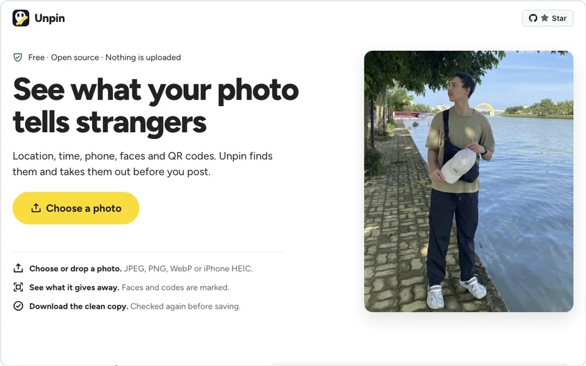

# Unpin

[](https://github.com/sergeybolden/unpin/actions/workflows/pages.yml)
[](LICENSE)

**See what your photo tells strangers. Then take it out.**

[](https://unpin.sergeybolden.com/)

**[Open Unpin →](https://unpin.sergeybolden.com/)** Runs in your browser. Nothing is uploaded.

Drop a photo (JPEG, PNG, WebP, HEIC or AVIF) and Unpin shows, in plain words, what it gives away:

- **where** it was taken, on a map, with the nearest city;
- **when**, to the minute;
- **what with**: phone or camera, lens, software;
- **serial numbers** that link all photos from one camera;
- **names** written into the file;
- a **hidden preview** that can show the picture before you cropped it;
- **AI prompts** that image generators store inside PNG files;
- **whether it was made with AI, and with what**: ChatGPT, Midjourney, Adobe Firefly, Google, Meta, Stable Diffusion and others, read from Content Credentials, the IPTC AI label or the generator's settings (labels only: a screenshot or a re-save removes them, so "no label" doesn't mean "real");
- **faces, QR codes and barcodes** on the picture itself.

One click removes the data, blurs faces and covers codes. Before the download starts, Unpin reads the finished file again and checks each item: location, time, device, serial numbers, names, hidden preview, Content Credentials, and whether the covered codes can still be scanned. If something is still there, it says so instead of downloading. Faces are blurred but not re-checked, and that is stated too.

## Why the picture matters too

Removing location data is no longer enough. Since 2025, chat assistants can often guess where a photo was taken from the background alone: a street sign, a shop name, trees, the view from a window. Unpin finds faces and codes for you and lets you cover anything else with a drag. It also lists what to look for, because no tool can find every clue.

## What stays

- **The picture itself.** JPEG, PNG and WebP are cleaned block by block, without re-compressing a single pixel.
- **Color and rotation.** The color profile and the photo's rotation stay; the profile keeps only its colors and a standard or neutral name, without the device, the date or any text.
- **Only what a viewer shows.** A second picture or frame hidden in the file is never copied, and such a file is saved again instead. PNG picture data is unpacked and checked too: if it holds more than the picture, the PNG is saved again.
- **One limit.** When Unpin cleans a JPEG or WebP without saving it again, it keeps the original compressed picture data, so data deliberately added inside it may stay in the downloaded file. Phones and cameras don't do this.
- **When the picture is saved again.** HEIC and AVIF are saved as JPEG. If you cover something, the picture is saved again at high quality, and an animation becomes a still image.

## What goes

Everything listed above, and also:

- **Content Credentials (C2PA)** are removed. They are signed over the whole file, so they can't stay valid once other data is taken out, and they can carry a location or a preview.
- **The "made with AI" label** (the IPTC digital source type) is removed too. Unpin still tells you it was there before you download. An invisible watermark in the pixels, such as Google's SynthID, is not a label and stays.

## Privacy

- Everything runs in the tab: [exifr](https://github.com/MikeKovarik/exifr) reads the metadata, [MediaPipe](https://github.com/google-ai-edge/mediapipe) finds faces, [zxing-wasm](https://github.com/Sec-ant/zxing-wasm) finds codes.
- No analytics, no third-party fonts or scripts. The page's Content Security Policy blocks connections to any other server.
- The map is drawn from bundled [Natural Earth](https://www.naturalearthdata.com) outlines, and the nearest city comes from bundled [GeoNames](https://www.geonames.org) data, so the location never reaches a map service.
- Offline: the page and metadata cleaning are saved on the first visit. The face finder (about 15 MB) and the HEIC decoder (3 MB) are saved the first time you use them, or at once with the "Save everything for offline use" button in the site's FAQ.

## Run it yourself

It's a static site, with no build step:

```bash
git clone https://github.com/sergeybolden/unpin
cd unpin
python3 -m http.server 8000 --bind 127.0.0.1
```

Then open http://127.0.0.1:8000. The tests and library updates need Node.js: run `npm install` once, then `npm test` (the same tests run before every deploy) or `npm run vendor` to update the bundled libraries.

## Contributing

Bug reports and fixes are welcome: see [CONTRIBUTING.md](CONTRIBUTING.md). To report a security problem privately, see [SECURITY.md](SECURITY.md).

## License

MIT. Third-party code and data are listed in [vendor/LICENSES](vendor/LICENSES/README.md).

Made by [Sergey Bolden](https://www.threads.com/@sergeybolden), a solo founder building products with AI agents.
